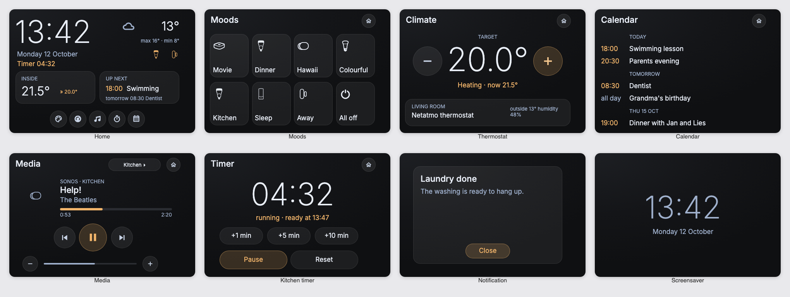

# NSPanel for Homey

A Homey dashboard for the **Sonoff NSPanel (EU)**: a dark, image-based display design, a thin ESPHome firmware and a Homey Pro app that drives everything live.

It started from [Blackymas' NSPanel HA Blueprint](https://github.com/Blackymas/NSPanel_HA_Blueprint) (built for Home Assistant) and replaces its Home Assistant side with a Homey app.



<sub>Renders of the display design with sample data, in English ([Dutch version](docs/screenshots-nl.png)). Regenerate with `bun design/export.ts && bun design/screenshots.ts [en|nl]`.</sub>

**Pages**
- **Home:** clock, date, weather, the inside temperature and up to 7 device chips (any Homey capability), plus the next calendar item.
- **Moods:** 8 tiles. Each one starts a Homey mood or flow, toggles a device, or just fires a flow trigger.
- **Thermostat:** one thermostat with its target temperature.
- **Calendar:** any public iCal link, such as a shared iCloud calendar.
- **Media:** whichever of your speakers is playing (Sonos, Apple TV and other `speaker_*` devices), with cover art, controls and volume.
- **Kitchen timer:** runs on the panel itself, so it also works when Homey is offline.
- **Notifications and screensaver.**

The two physical buttons can switch their relays or only send flow triggers. The app pushes changes to the panel as they happen (no polling). The panel's language (English or Dutch), time format and screensaver are set in Homey.

## What's in this repo

| Path | What |
|---|---|
| `firmware/` | ESPHome firmware for the panel (`nspanel.yaml`, `nspanel_ui.h`) |
| `tft/nextion/` | Nextion Editor project (`.HMI`), the compiled display file (`.tft`) and the generated fonts (`.zi`) |
| `tft/` | Display design docs: component map (`COMPONENTS.md`), build guides, page images and fonts |
| `design/` | The display design as code: layout → page images, component map, Editor guides |
| `drivers/`, `lib/`, `settings/`, `api.ts` | The Homey app |
| `scripts/` | TFT upload helper, icon font pipeline |

## What you need

- A Sonoff NSPanel **EU** (the square 480×320 model).
- A Homey Pro (2023 or later) on the same network.
- On your computer: [ESPHome](https://esphome.io/guides/installing_esphome) 2026.6 or newer, [Bun](https://bun.sh) and the [Homey CLI](https://apps.developer.homey.app/the-basics/getting-started) (`bunx homey` works too).
- For the very first flash only: a USB-to-serial adapter (3.3 V).

## 1. Firmware

1. Create your secrets file and fill it in:

   ```sh
   cp firmware/secrets.example.yaml firmware/secrets.yaml
   ```

   - `wifi_ssid` and `wifi_password`: your Wi-Fi.
   - `api_encryption_key`: a random 32-byte key, for example from `openssl rand -base64 32`. You enter the same key in Homey later.
   - `ota_password`: the password for updates over Wi-Fi. When you're replacing other firmware over Wi-Fi, this must be the password of the firmware that is on the panel now.

2. Set the device name: change `name` under `substitutions` at the top of `firmware/nspanel.yaml` (for example `nspanel-living`).

3. Compile and flash:

   ```sh
   esphome compile firmware/nspanel.yaml
   ```

   - **The panel already runs ESPHome**, for example Blackymas: update over Wi-Fi with `esphome upload firmware/nspanel.yaml --device <panel-ip>`.
   - **The panel still runs the Sonoff firmware:** the first flash goes over USB-serial. Follow the [Blackymas install guide](https://github.com/Blackymas/NSPanel_HA_Blueprint/blob/main/docs/install.md) for opening the panel, wiring and boot mode, but flash this firmware instead of theirs (`esphome run firmware/nspanel.yaml`, then pick the serial port). After that, every update goes over Wi-Fi.

More detail, including how to go back to Blackymas: [`firmware/README.md`](firmware/README.md).

## 2. Display (TFT)

The panel's screen has its own firmware: `tft/nextion/nspanel_soft_dark.tft`. It is uploaded over Wi-Fi via the ESP.

1. **If you just flashed the firmware, wait at least a minute.** A new firmware only counts as good after 60 seconds of uptime. If the upload reboots the panel before that, the panel falls back to the previous firmware.
2. If the Homey app is already installed, **disable it** for now (Homey → Apps → NSPanel → Disable). The upload blocks the panel for about 12 minutes.
3. From the repo folder:

   ```sh
   bun install
   bun scripts/upload-tft.ts --panel <panel-ip>
   ```

   The script serves the file from your computer and tells the panel to fetch it at 115200 baud. Follow progress with `esphome logs firmware/nspanel.yaml --device <panel-ip>`. The panel reboots when the upload is done.
4. Enable the Homey app again.

If an upload fails, reboot the ESP before retrying (flash the same firmware again over Wi-Fi), then run the script again. The display continues where it stopped. The [Blackymas TFT upload guide](https://github.com/Blackymas/NSPanel_HA_Blueprint/blob/main/docs/tft_upload.md) covers more failure modes; the [lessons learned](firmware/README.md#tft-upload-lessons-learned) list what bit us.

## 3. Homey app

1. Install the app on your Homey:

   ```sh
   bun install
   bunx homey login
   bunx homey app install
   ```

   If the Homey cloud rate-limits you, add `--discovery-strategies local`.

2. In Homey, add a device: **NSPanel** → it is found on your network (ESPHome mDNS). Open the device settings and enter the **Encryption Key** from `secrets.yaml`. Check the IP address too.
3. Configure the dashboard in **Homey → Apps → NSPanel → Settings**:
   - **Home:** thermostat and chips.
   - **Moods:** the 8 tiles.
   - **Media:** your speakers, in order of preference.
   - **Calendar:** the iCal link, which you can test there.
   - **Screen:** screensaver and button modes.

   The device settings hold the panel language, the date and time format, and weather.

### More than one panel

Every panel is its own Homey device with its own dashboard. Pick the panel at the top of the settings page; chips, moods, media players, calendar, screen and buttons are saved per panel, and so are language and time format (device settings). For the firmware, give every panel its own `name` in `firmware/nspanel.yaml` (the secrets can be shared) and flash each one.

Flow cards: show or clear a notification, go to a page, play a sound, wake the screen, refresh the calendar, start the kitchen timer; triggers for the physical buttons, mood tiles and "kitchen timer finished".

## Changing the display design

The display is image-based: every page is a picture with text fields on top. Pictures and the component map are generated from `design/layout.ts`:

```sh
bun design/export.ts       # page images → tft/assets/
bun design/components.ts   # component map → tft/COMPONENTS.md
```

Then open `tft/nextion/nspanel_soft_dark.HMI` in [Nextion Editor](https://nextion.tech/nextion-editor/) (Windows; on a Mac it runs under CrossOver), apply the changes, compile, and export the `.tft`.
- `tft/BUILD.md` covers the full build.
- `tft/ROUND2.md` is an example of an incremental update.

After rebuilding, update the font and picture ids in `lib/tftIds.json`.

The panel icons are a font built from the [Homey icon set](https://github.com/athombv/homey-vectors-public) plus your devices' own icons: `scripts/icon-font/build.py`. Nextion Editor's font generator drops private-use characters, so the icons are mapped to U+4E00 and up.

## Development

```sh
bun test            # app, design and firmware (host-compiled C++) tests
bunx tsc --noEmit
bunx homey app validate
```

## Credits and license

- Hardware support, the TFT boot page and the original Nextion project: [Blackymas/NSPanel_HA_Blueprint](https://github.com/Blackymas/NSPanel_HA_Blueprint) and its contributors.
- Fonts: [Inter](https://rsms.me/inter/) (SIL OFL), plus the Ubuntu and Noto fonts that came with the Blackymas project.
- Icons: [Homey icons](https://github.com/athombv/homey-vectors-public) by Athom, and [Material Design Icons](https://pictogrammers.com/library/mdi/) for the weather.

This project is licensed under the GNU GPL v3; see [`LICENSE`](LICENSE).
